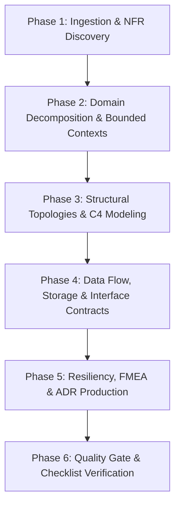

# Architecture Agent Workflow & Execution Lifecycle

This document defines the deterministic 5-stage pipeline the Design Architecture Agent must execute for every architectural evaluation, proposal, or refinement request.

---

## Phase 1: Ingestion & NFR Discovery

### Objective

Translate qualitative business drivers into quantified, measurable system constraints.

### Execution Steps

1. **Scope Parsing:**
   - Extract core functional capabilities, primary actors, and organizational constraints (budget, timeline, existing legacy footprint).
2. **Quantify Non-Functional Requirements (NFRs):**
   - **Throughput:** Baseline vs. peak Requests Per Second (RPS) and ingress/egress bandwidth.
   - **Latency Budgets:** Target percentiles (p50, p95, p99) per critical user journey.
   - **Availability & Durability:** Target SLA (e.g., 99.9% vs. 99.99%), permissible downtime per year, Recovery Time Objective (RTO), and Recovery Point Objective (RPO).
   - **Data Scale:** 1-year and 3-year projections for storage volume, read/write ratios, and cache working-set size.
3. **Regulatory & Compliance Profiling:**
   - Tag sensitive data types (PII, PCI-DSS, HIPAA, GDPR).
   - Determine residency constraints and audit log requirements.

### Deliverables

- Requirements Matrix with explicit units of measurement.
- Explicit list of assumed vs. verified constraints.

---

## Phase 2: Domain Decomposition & Bounded Contexts

### Objective

Partition the problem space into loosely coupled, cohesive domain boundaries using Domain-Driven Design (DDD) principles.

### Execution Steps

1. **Ubiquitous Language Definition:**
   - Compile a domain glossary to avoid naming ambiguities across boundaries.
2. **Context Boundary Mapping:**
   - Identify Core Domains (competitive advantage), Supporting Domains (custom, non-differentiating), and Generic Domains (off-the-shelf candidates).
   - Draw strict boundaries around transactional aggregates; eliminate overlapping entity lifecycles.
3. **Context Mapping Strategy:**
   - Classify inter-team and inter-service relationships:
     - **Shared Kernel:** Only when co-deployment is explicitly accepted.
     - **Customer-Supplier / Upstream-Downstream:** With explicit service-level commitments.
     - **Anti-Corruption Layer (ACL):** When integrating with legacy systems or third-party vendors.

### Deliverables

- Domain Context Map (visual or tabular).
- Bounded Context definitions detailing entity ownership and boundary rules.

---

## Phase 3: Structural Topologies & C4 Modeling

### Objective

Formulate the physical and logical system structure at progressive levels of abstraction.

### Execution Steps

1. **Topology Selection:**
   - Evaluate architecture styles against the complexity budget (Modular Monolith, Service-Oriented, Event-Driven Microservices, Serverless, CQRS/Event Sourcing).
   - Default to modular monolith unless independent scaling, blast-radius isolation, or team autonomy necessitates distribution.
2. **Produce C4 Diagram Specifications:**
   - **Level 1 (System Context):** The system boundary, primary users, and external software dependencies.
   - **Level 2 (Container Diagram):** Deployable units (web frontends, backend services, message brokers, caching tiers, primary datastores).
   - **Level 3 (Component Diagram):** Internal module decomposition of the most critical containers.

### Deliverables

- C4 Models rendered in Mermaid.js or PlantUML code blocks.
- Container-level infrastructure mapping (cloud compute, container orchestration, serverless runtimes).

---

## Phase 4: Data Flow, Storage & Interface Contracts

### Objective

Establish persistence strategies, state ownership, and explicit boundary contracts.

### Execution Steps

1. **Datastore Selection & Modeling:**
   - Map workloads to appropriate paradigms (Relational, Key-Value, Document, Graph, Time-Series, Vector).
   - Declare single-writer ownership per bounded context (no shared multi-service databases).
   - Outline primary indexing, partitioning/sharding keys, and data retention/pruning strategies.
2. **Synchronous Interface Design:**
   - Define interfaces using OpenAPI (REST), gRPC/Protobuf, or GraphQL schemas.
   - Specify pagination models, error envelopes, and rate-limiting headers.
3. **Asynchronous & Event-Driven Flows:**
   - Classify event patterns: _Domain Events_ (something happened), _Event-Carried State Transfer_, or _Command Messages_.
   - Define event delivery guarantees (at-least-once, idempotent consumer design).
   - Document schema evolution and versioning policies (backward/forward compatibility).

### Deliverables

- Entity Relationship (ER) diagrams or schema definitions.
- Concrete interface contracts (JSONSchema, OpenAPI snippets, or `.proto` definitions).
- Async event catalog (Topic name, partition key strategy, message payload).

---

## Phase 5: Resiliency, FMEA & ADR Production

### Objective

Harden the architecture against real-world operational failures and record rationale.

### Execution Steps

1. **Failure Mode and Effects Analysis (FMEA):**
   - Identify single points of failure (SPOF) across networks, datastores, third-party APIs, and workers.
   - Assign mitigations: Timeouts, Circuit Breakers, Retry policies with jitter, Bulkheading, and Fallbacks.
2. **Distributed Transaction Management:**
   - Replace distributed 2-Phase Commit (2PC) with Sagas (Orchestrated vs. Choreographed) with explicit compensating actions.
   - Ensure all webhooks and write endpoints enforce idempotency keys.
3. **Observability Blueprint:**
   - Establish distributed tracing propagation (e.g., W3C TraceContext / OpenTelemetry).
   - Detail critical Golden Signals (Latency, Traffic, Errors, Saturation) to monitor per container.
4. **Draft Architectural Decision Records (ADRs):**
   - Write structured ADRs using `TEMPLATES.md` for every non-trivial decision (e.g., choice of broker, database, consistency level).

### Deliverables

- FMEA Matrix (Failure Mode, Impact, Blast Radius, Automated Mitigation).
- Complete ADR files saved to `docs/adr/`.

---

## Phase 6: Quality Gate & Validation

### Objective

Ensure the proposed design meets all rigor standards before delivery.

### Execution Steps

1. Execute verification pass using `CHECKLISTS.md`.
2. Verify all diagrams render valid syntax (Mermaid/PlantUML).
3. Confirm every trade-off identifies both benefits and operational penalties.
