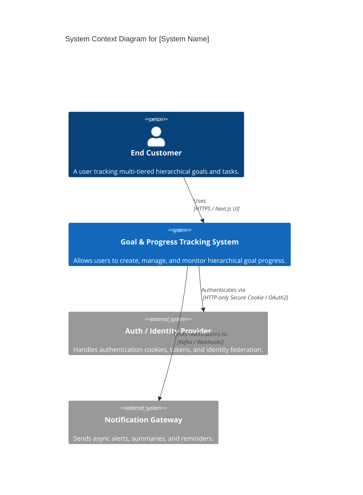
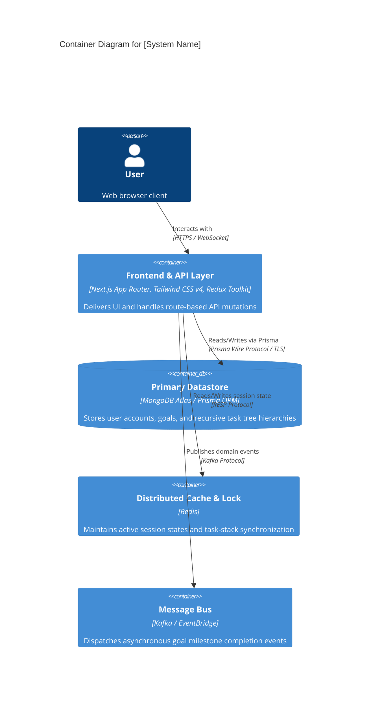
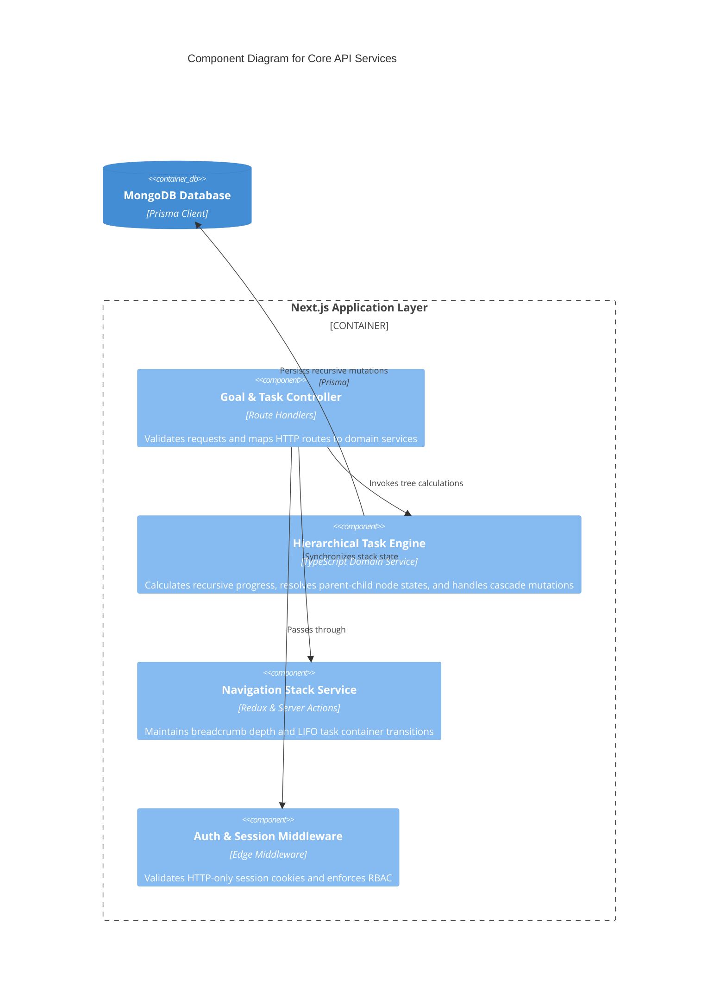

# Architectural Output Templates

This document provides standardized production-ready templates that the Architecture Agent must use when drafting deliverables. All placeholders marked with `[...]` must be concretely filled.

---

## 1. Architectural Decision Record (ADR)

Save file under: `docs/adr/ADR-[NNN]-[kebab-case-title].md`

```markdown
# ADR-[NNN]: [Short Descriptive Title]

## Metadata

- **Status:** [Draft | Proposed | Accepted | Rejected | Deprecated | Superseded by ADR-XXX]
- **Date:** YYYY-MM-DD
- **Decision Makers:** [Architects, Tech Leads, Engineering Directors]
- **Consulted:** [Security, SRE, Product Management, Domain Experts]
- **Informed:** [All Engineering Teams, Operations]

---

## 1. Context and Problem Statement

- **Business Driver:** What commercial or product need triggers this decision?
- **Technical Problem:** What specific technical friction, bottleneck, or requirement must be resolved?
- **Scope & Constraints:**
  - Team competencies & organizational topology
  - Delivery timelines and operational budget
  - Target latency, throughput, or availability targets
  - Existing infrastructure commitments and vendor constraints

---

## 2. Decision Drivers (Key Criteria)

1. **Primary Driver 1:** [e.g., Target p99 latency < 50ms at 25,000 RPS]
2. **Primary Driver 2:** [e.g., Zero-downtime rolling upgrades and independent service deployments]
3. **Primary Driver 3:** [e.g., Compliance requirement for strict audit logging and data residency]
4. **Primary Driver 4:** [e.g., Maintainability and total operational burden on on-call engineers]

---

## 3. Considered Options

- **Option 1:** [Name / Brief Summary]
- **Option 2:** [Name / Brief Summary]
- **Option 3:** [Name / Brief Summary]

---

## 4. Evaluation Matrix

| Evaluation Criteria             | Weight (1-5) | Option 1: [Name]        | Option 2: [Name]        | Option 3: [Name]        |
| ------------------------------- | ------------ | ----------------------- | ----------------------- | ----------------------- |
| Performance / Scalability       | [e.g., 5]    | Score (1-5) - Rationale | Score (1-5) - Rationale | Score (1-5) - Rationale |
| Operational Complexity          | [e.g., 4]    | Score (1-5) - Rationale | Score (1-5) - Rationale | Score (1-5) - Rationale |
| Developer Ergonomics & Velocity | [e.g., 3]    | Score (1-5) - Rationale | Score (1-5) - Rationale | Score (1-5) - Rationale |
| Cost (Infra + Licensing)        | [e.g., 4]    | Score (1-5) - Rationale | Score (1-5) - Rationale | Score (1-5) - Rationale |
| Ecosystem & Community Support   | [e.g., 2]    | Score (1-5) - Rationale | Score (1-5) - Rationale | Score (1-5) - Rationale |
| **Weighted Total**              |              | **[Total 1]**           | **[Total 2]**           | **[Total 3]**           |

---

## 5. Decision Outcome & Rationale

We chose **[Option X]** as the architectural standard.

### Core Rationale

1. [Core Factor 1: Concrete reason why Option X outranked alternatives]
2. [Core Factor 2: Specific architectural fit with current system patterns]
3. [Core Factor 3: Risk mitigation profile]

---

## 6. Consequences & Trade-offs

### Positive Consequences (Gains)

- [Gain 1: Measurable improvement in performance/throughput/cost]
- [Gain 2: Improved isolation boundary or developer velocity]

### Negative Consequences (Liabilities & Trade-offs)

- [Liability 1: Added operational complexity, newly introduced SPOF or tooling requirements]
- [Liability 2: Learning curve or migration friction]

### Neutral Consequences

- [System behavior or workflows that remain unaffected]

---

## 7. Mitigation Strategies

- **Mitigation for Liability 1:** [Concrete technical guardrail, tooling, runbook, or alerting]
- **Mitigation for Liability 2:** [Documentation, golden templates, training, or incremental migration plan]

---

## 8. Implementation & Transition Plan

- **Phase 1 (Proof of Concept):** [Milestone & validation gate]
- **Phase 2 (Shadow / Canary):** [Traffic split, error baseline comparison]
- **Phase 3 (Full Cutover & Decommission):** [Legacy system retirement]

---

## 9. References & Appendices

- Link to RFC / Jira Ticket: [URL/Ticket-ID]
- Benchmark Results / Load Testing Data: [URL/Path]
- Relevant Architectural Standards: [ADR-YYY]
```

---

## 2. Component Interface Specification

Save file under: `docs/components/[component-name]-spec.md`

````markdown
# Component Specification: [Component Name]

## 1. Overview & Ownership

- **Component ID:** `svc-[name]` / `pkg-[name]`
- **Owning Team:** [Team Name & Slack Channel]
- **Classification:** [Core Domain | Supporting Subdomain | Generic Utility]
- **Primary Function:** [Single-sentence description of the component's sole responsibility]

---

## 2. Boundary Responsibilities

### What this Component DOES:

- [Explicit responsibility 1]
- [Explicit responsibility 2]

### What this Component DOES NOT DO (Out of Scope):

- [Explicitly excluded responsibility 1 - handled by svc-other]
- [Explicitly excluded responsibility 2]

---

## 3. Dependency Graph

### Upstream Consumers (Callers)

| Consumer Service / Client | Communication Protocol | Typical RPS   | Criticality (P0-P3) |
| ------------------------- | ---------------------- | ------------- | ------------------- |
| [e.g., API Gateway]       | [gRPC / HTTPS]         | [e.g., 1,500] | [P0]                |
| [e.g., Order Worker]      | [Kafka Consumer Group] | [e.g., 200]   | [P1]                |

### Downstream Dependencies

| Target Dependency        | Type (DB/Cache/Service/Queue) | Protocol   | Timeout (ms) | Circuit Breaker Policy              |
| ------------------------ | ----------------------------- | ---------- | ------------ | ----------------------------------- |
| [e.g., Postgres Cluster] | Primary Relational DB         | TCP / Pool | 200ms        | Max pool size 50, drop queue        |
| [e.g., Redis]            | Distributed Cache             | TCP        | 25ms         | Fallback to primary DB on miss/fail |
| [e.g., Payment Gateway]  | External 3rd Party API        | HTTPS      | 1500ms       | Open circuit at 30% errors / 15s    |

---

## 4. Public Interface Contracts

### 4.1 Synchronous Endpoints (REST / gRPC)

#### Endpoint: `[METHOD] /v1/[resource]` / RPC: `[ServiceName].[MethodName]`

- **Description:** [Purpose of endpoint]
- **Idempotency Guarantee:** [Strictly Idempotent via Idempotency-Key header | Non-idempotent]
- **Rate Limit:** [e.g., 100 req/sec per tenant]

**Request Schema:**

```json
{
  "$schema": "http://json-schema.org/draft-07/schema#",
  "title": "ExampleRequest",
  "type": "object",
  "required": ["requestId", "tenantId", "payload"],
  "properties": {
    "requestId": { "type": "string", "format": "uuid" },
    "tenantId": { "type": "string" },
    "payload": { "type": "object" }
  }
}
```
````

**Response Schema (Success):**

```json
{
  "status": "SUCCESS",
  "data": {
    "id": "uuid-string",
    "createdAt": "2026-10-06T12:00:00Z"
  }
}
```

**Standard Error Schema:**

```json
{
  "errorCode": "RESOURCE_CONFLICT",
  "message": "Resource with specified idempotency key is currently processing",
  "timestamp": "2026-10-06T12:00:00Z",
  "traceId": "trace-abcdef-123456"
}
```

---

### 4.2 Asynchronous Event Contracts

#### Published Events

- **Topic / Event Stream:** `domain.[context].[entity].[action].v1`
- **Partition Key Strategy:** `tenantId` / `entityId` (guarantees per-entity ordering)
- **Delivery Guarantee:** At-least-once

**Event Envelope:**

```json
{
  "specversion": "1.0",
  "type": "com.company.order.created",
  "source": "/services/order-service",
  "id": "event-uuid-456",
  "time": "2026-10-06T12:00:00Z",
  "datacontenttype": "application/json",
  "data": {
    "orderId": "ord-98765",
    "totalAmount": 149.99,
    "currency": "USD"
  }
}
```

#### Subscribed Events

- **Topic:** `domain.billing.payment.captured.v1`
- **Consumer Group:** `order-service-payment-listeners`
- **Idempotency Deduplication Key:** `event.id` stored in Redis with 72h TTL
- **Dead-Letter Queue (DLQ):** `domain.billing.payment.captured.dlq` (Max retries: 5, exponential backoff)

---

## 5. Data Model & Storage Strategy

- **Datastore Engine:** [e.g., PostgreSQL 16 / MongoDB Atlas 7.0]
- **Data Isolation:** Single-writer principle strictly enforced; no direct DB connections from other services.
- **Key Tables / Collections:**
  - `orders`: Primary entity state
  - `idempotency_records`: Request deduplication cache
- **Archival / TTL Policy:** Hot data retained 90 days; cold batch archive to S3 Parquet daily.

---

## 6. Resiliency & Operational SLA Policies

- **Target SLA:** 99.95% uptime
- **Timeout Budget:** Total upstream execution cap: 500ms
- **Retry Policy:** Max 3 attempts with exponential backoff and randomized full jitter
- **Bulkhead Isolation:** Dedicated thread pool / connection pool for external network requests
- **Graceful Degradation / Fallback:** Return cached read model or queue writes to local write-ahead buffer

````

---

## 3. Failure Mode and Effects Analysis (FMEA)
Save file under: `docs/architecture/FMEA-[system-name].md`

```markdown
# Failure Mode and Effects Analysis (FMEA)

## System: [System / Subsystem Name]
- **Last Evaluated:** YYYY-MM-DD
- **Target SLA:** [e.g., 99.99%]
- **Max Permissible MTTR:** [e.g., 15 minutes]

| Component / Path | Failure Mode | Severity (1-5) | Probability (1-5) | Detection (1-5) | Risk Priority Number (RPN) | Automated Mitigation | Recovery / Fallback Procedure |
|-------------------|--------------|----------------|-------------------|-----------------|----------------------------|----------------------|--------------------------------|
| Primary Database | Master node crash / failover stall | 5 | 2 | 2 | 20 | Managed multi-AZ auto-failover; connection pool fast reconnect | Promote read replica; alert PagerDuty P0 |
| Distributed Cache (Redis) | Cluster eviction / network partition | 3 | 3 | 1 | 9 | Read-through fallback to replica DB; rate limiting to prevent stampede | Redis cluster scale-up; circuit breaker on cache reads |
| Message Broker (Kafka) | Broker broker unreachable / backpressure | 4 | 2 | 2 | 16 | Producer buffer in memory with spillover to local disk; backoff retry | Consumer lag auto-scaling; spillover to dead-letter queue |
| Downstream 3rd-Party API | 504 Gateway Timeout or hard downtime | 3 | 4 | 1 | 12 | Circuit breaker trips after 50% failures over 10s window | Return degraded response or optimistic confirmation to user |
| Auth Service | JWT validation key rotation mismatch | 5 | 1 | 2 | 10 | Local JWKS cache with 15-minute grace period on rotation | Re-fetch JWKS via background worker; fallback to stale keys |

*Notes:*
- **Severity (S):** 1 (Negligible) to 5 (Catastrophic service outage / data corruption).
- **Probability (P):** 1 (Extremely unlikely) to 5 (Frequent / anticipated weekly).
- **Detection (D):** 1 (Immediate automated alert) to 5 (Undetected until user reports).
- **RPN Formula:** $RPN = Severity 	imes Probability 	imes Detection$. Any item with $RPN \ge 25$ or $Severity = 5$ requires a non-negotiable automated failover.
````

---

## 4. C4 Architecture Specification

Save file under: `docs/architecture/C4-MODELS.md`

````markdown
# C4 Architecture Model: [System Name]

## Level 1: System Context Diagram

Shows how the system fits into the broader enterprise and user landscape.


````

---

## Level 2: Container Diagram

Shows the high-level technical shape of the system (applications, databases, storage).



---

## Level 3: Component Diagram (Focus: Task & Goal Processing Engine)

Breaks down the core business logic container into modular components.



```

```
