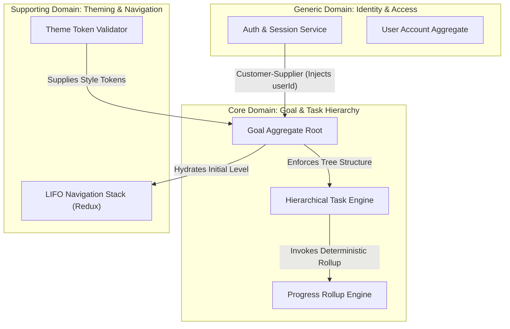

# Phase 2: Domain Decomposition & Bounded Contexts
**Project:** Progress Tracker (Hierarchical Goal & Task Orchestration System)  
**Date:** 2026-10-06  
**Status:** Complete  

---

## 1. Ubiquitous Language Glossary

| Term | Domain Concept | Definition & Invariants |
| :--- | :--- | :--- |
| **Goal** | Core Domain | Top-level objective owned by a User. Possesses title, theme styling (`bgColor`, `textColor`), and serves as root for task hierarchies. |
| **Task / Subtask** | Core Domain | A granular unit of work within a Goal. Can contain $0..N$ subtasks (recursive tree node). Holds `title`, `description`, `isCompleted`, and computed `progress`. |
| **Tree Node** | Core Domain | The structural representation of a task within the hierarchy, retaining parent reference (`parentId`) or nested sub-array representation. |
| **Progress Rollup** | Core Domain | Deterministic percentage calculation: if a task has subtasks, its completion % is the weighted or average completion of its children; if leaf, $0\%$ or $100\%$. |
| **Navigation Stack** | Core Domain (Client) | A LIFO (Last-In-First-Out) state model tracking user drilldown inside a Goal accordion. Pushing a task displays its direct subtasks; popping returns to parent level. |
| **Theme Profile** | Supporting Domain | Visual configuration attributes (`backgroundColor`, `textColor`) validated for contrast and rendered dynamically per goal card/accordion. |
| **Identity / Session** | Generic Domain | User authentication state maintained via HTTP-only secure cookie, binding requests to an authenticated `userId`. |

---

## 2. Bounded Context Map

---

## 3. Domain Boundary & Aggregate Definitions

### 3.1 Goal & Task Hierarchy Aggregate (Core Domain)
- **Aggregate Root:** `Goal`
- **Internal Entities:** `TaskNode` (recursive child)
- **Invariants:**
  1. Deleting a parent task recursively cascades deletion to all child subtasks.
  2. Marking a parent as completed can either cascade to all subtasks or reflect 100% rollup completion.
  3. Every task must resolve to a valid root `GoalId`.
  4. Circular parent-child hierarchies are strictly disallowed ($A \rightarrow B \rightarrow A$ rejected).

### 3.2 Identity & Access Management (Generic Domain)
- **Aggregate Root:** `User`
- **Entities/Value Objects:** `SessionCookie`, `HashedPassword`, `UserEmail`
- **Invariants:**
  1. Email must be unique.
  2. Passwords salted with bcrypt / argon2.
  3. Session token must be verified via Edge Middleware before accessing `/dashboard` or `/profile`.

### 3.3 Theme & Presentation (Supporting Domain)
- **Value Objects:** `ThemeColor` (`bgHex`, `textHex`)
- **Invariants:**
  1. Color values must conform to valid hex/RGB/HSL strings.
  2. Contrast validation applied to ensure accessibility compliance.

---

## 4. Context Mapping Relationships

- **Identity $\rightarrow$ Goal Context:** **Upstream / Downstream (Customer-Supplier)**. Identity issues verified session context (`userId`). Goal context treats `userId` as an immutable partition key.
- **Goal $\rightarrow$ Client Navigation:** **Publisher / Subscriber**. The server emits the canonical goal/task tree state; client Redux Toolkit orchestrates the local LIFO drilldown viewport stack without polluting database aggregates.
