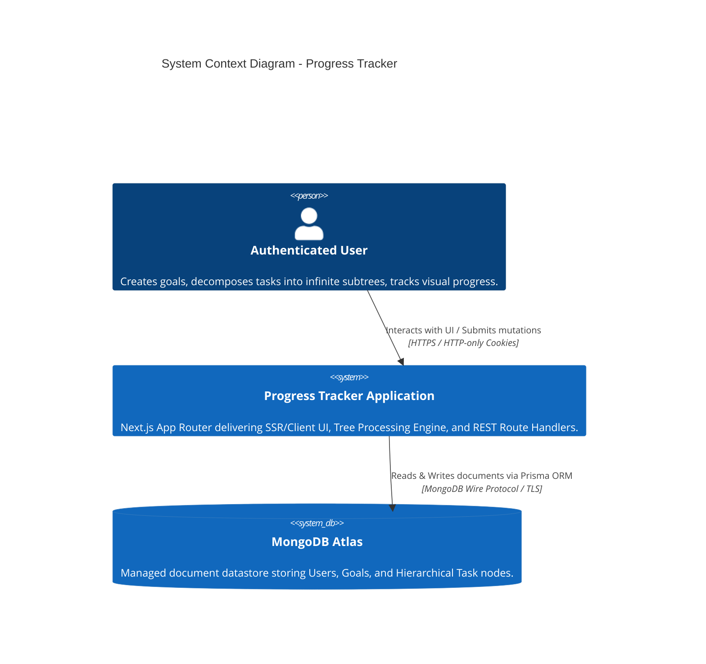
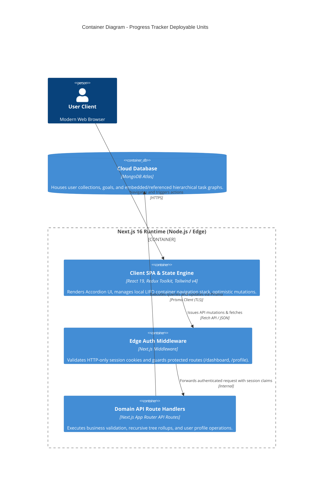
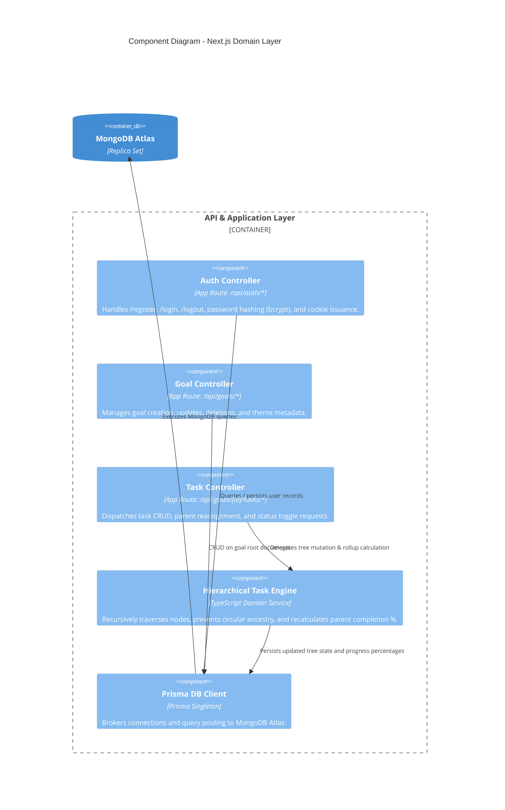

# Phase 3: Structural Topologies & C4 Modeling
**Project:** Progress Tracker (Hierarchical Goal & Task Orchestration System)  
**Date:** 2026-10-06  
**Status:** Complete  

---

## 1. Architectural Topology Evaluation

### Selected Topology: Modular Monolith (Next.js Full-Stack Runtime)

**Rationale & Complexity Budget:**
- **Distribution Overhead:** Zero network hops between UI orchestration and API services.
- **Transactional Simplicity:** Single deployment unit simplifies atomic tree updates and eliminates distributed saga coordination.
- **Scalability Profile:** Stateless Next.js instances scale horizontally behind an L7 load balancer; database operations scale independently on MongoDB Atlas.

---

## 2. C4 Architecture Models

### 2.1 Level 1: System Context Diagram

---

### 2.2 Level 2: Container Diagram

---

### 2.3 Level 3: Component Diagram (API & Business Logic)

---

## 3. Container-Level Infrastructure Mapping

| Container | Runtime / Compute | Memory / CPU Target | Scaling Strategy |
| :--- | :--- | :--- | :--- |
| **Next.js Web / API** | Node.js 20 LTS (Vercel / Container) | 512MB - 1GB RAM, 1 vCPU | Auto-scaling horizontal stateless replicas |
| **Edge Middleware** | Edge Runtime (V8 isolates) | 128MB RAM, ultra-low latency | Global edge network point of presence |
| **Client Redux Store** | Browser Client Memory | < 50MB browser footprint | Client-side memory execution |
| **MongoDB Atlas** | Managed M10+ Replica Set | 2GB - 4GB RAM, Multi-AZ | Cloud replica set auto-failover with daily snapshots |
